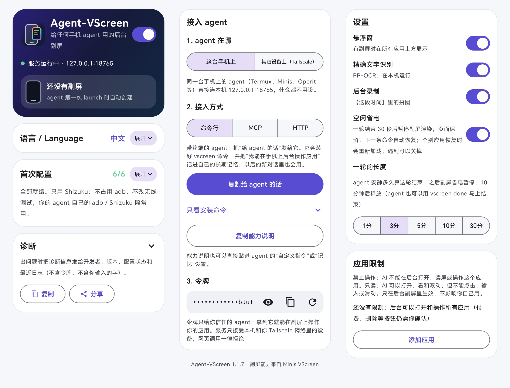

<p align="center"></p>

# Agent-VScreen

<p align="center">
  <a href="https://github.com/kilolonion/agent-vscreen/releases/latest"></a>
  <a href="LICENSE"></a>
  
  
  
</p>

**A background second screen for any phone agent.**

[中文](README.md) · English

Agent-VScreen opens and drives other apps on an invisible virtual display, so your own screen stays yours. All you see is a small floating window showing what the AI is doing, which you can take over or stop at any moment.

Any agent on the phone can use it: agents with a terminal use the `vscreen` CLI, agents that speak MCP use MCP, and your own code can use plain HTTP.

<p align="center"></p>
<p align="center"><sub>Left: an agent solves sudoku in Chrome on the background screen (8x speed). Right: an agent plays Roco Kingdom in landscape, walking with the joystick, dragging the camera and handling battle pop-ups (2.6x speed). In both, the user's own screen stays on the chat app.</sub></p>

<p align="center"></p>
<p align="center"><sub>One install command: four different Android agents (Minis, Eta, RikkaHub, Muse) all connect and drive the background screen.</sub></p>

<p align="center"></p>
<p align="center"><sub>The app: first-time setup, connecting an agent (CLI / MCP / HTTP), settings and app restrictions.</sub></p>

- Version: 1.1.6 (versionCode 8) · [Download APK](https://github.com/kilolonion/agent-vscreen/releases/latest)
- Package: `com.kilon.agentvscreen`
- Android 11+ (Android 14+ recommended), arm64
- Privileges: [Shizuku](https://shizuku.rikka.app/) only, no root

## What it does

- **Drives apps in the background**: launch apps, tap, swipe, type, press keys and wait for the screen to change on the virtual display, verifying every step.
- **Reports the screen back**: after each action it returns the current screen, visible text and tappable elements, plus a screenshot. Built-in offline OCR (PaddleOCR, on device). The app calls no LLM itself; your agent's own model decides what the screen means.
- **Watches**: keep an eye on the background screen for a condition (say, some text appearing) and notify the agent when it is met.
- **Floating window**:
  - The border color shows who has the screen: rainbow while the AI works, blue when idle, green when you have taken over, red when you stopped it;
  - Drag to move, pinch to resize, fling to throw it; fling to a corner to shrink, push to the edge to fold it into a tab;
  - Press and hold the picture for 1 second to take over;
  - × closes it with one tap: while the AI is working it only hides the window and the AI keeps going; with no task it closes the background screen;
  - "Stop AI" at the bottom left is the only thing that stops the AI; a persistent notification with "Allow to continue" releases it.
- **Leaves your agent's own access alone**: it does not take adb, touch wireless debugging or restart adbd. One-tap setup only adds this app and never changes other apps' settings.
- **App restrictions**: block apps entirely or make them read-only for the AI. Payment, delete and similar buttons still need your confirmation.

## Install and set up

The app UI is in Chinese for now; button names below are translated.

1. Install the APK and open Agent-VScreen.
2. Make sure Shizuku is running, then tap **Grant Shizuku**.
3. Tap **One-tap setup** for the overlay, notifications, read-only accessibility, battery optimization and background running. On Honor, Huawei, Xiaomi, OPPO, vivo and similar phones, also open **System background management** and allow auto-start and background activity.
4. In **Connect agent**, tap **Copy message for agent** and send it to your agent as is. It installs the `vscreen` command and saves a short guide into its own long-term memory, so new conversations know the tool is there. The home screen shows whether it remembered. Then:

```sh
vscreen launch Settings
vscreen act "tap Search; type About phone; key enter until text:About phone"
vscreen help all
```

## Connecting from other devices (optional, off by default)

The service only listens on `127.0.0.1:18765`. To call it from a computer or another phone, pick **Built-in Tailscale** under **Let other devices connect**: no Tailscale app needed and no system VPN slot taken; sign in to Tailscale once inside the app and only devices on your own tailnet can reach it. **Tailscale app** mode and SSH port forwarding also work.

The token equals control of the phone, so the app never offers a public link.

## Docs

- [API.md](API.md) (Chinese): the full CLI, MCP and HTTP reference, sessions, watches, the floating window, remote access and known limits.

## Build from source

JDK 17 and the Android SDK (compileSdk 36).

```bash
echo "sdk.dir=/path/to/android-sdk" > local.properties
./gradlew :app:assembleRelease
```

Built-in Tailscale is a small Go program (`tsbridge/`, Go 1.21+). Run `tsbridge/build.sh` once before building to produce `app/src/main/jniLibs/arm64-v8a/libtsbridge.so`; without it the APK still builds, just without built-in Tailscale.

Release signing is optional: copy `keystore.properties.example` to `keystore.properties` and fill it in. Otherwise release builds are signed with the debug key.

## License

MIT. The bundled OCR models (`app/src/main/assets/vscreen-ocr/`) come from PaddleOCR under their own Apache-2.0 license.

## Thanks

- [LINUX DO](https://linux.do)
- [OpenMinis](https://github.com/OpenMinis)
