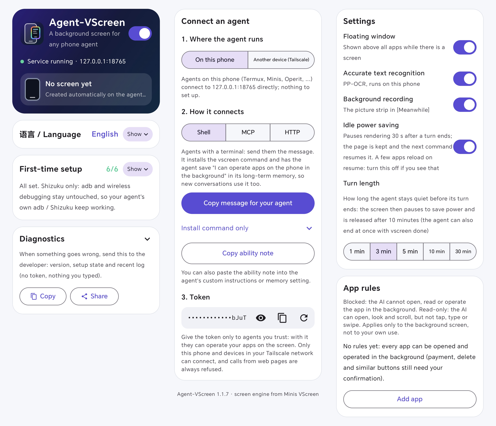

<p align="center"></p>

# Agent-VScreen

<p align="center">
  <a href="https://github.com/kilolonion/agent-vscreen/releases/latest"></a>
  <a href="LICENSE"></a>
  
  
  
</p>

**A background second screen for any phone agent.**

[中文](README.zh-CN.md) · English

Agent-VScreen opens and drives other apps on an invisible virtual display, so your own screen stays yours. All you see is a small floating window showing what the AI is doing, which you can take over or stop at any moment.

Any agent on the phone can use it: agents with a terminal use the `vscreen` CLI, agents that speak MCP use MCP, and your own code can use plain HTTP.

<p align="center"></p>
<p align="center"><sub>The app: Now (what the agent is doing on the background screen, take over or stop, recent runs), Connect (connected agents, remote access, tokens), Records (every task, question and plan with step thumbnails) and Settings (who can connect, how much an agent may do, app rules, floating window).</sub></p>

<p align="center"></p>
<p align="center"><sub>One install command: four different Android agents (Minis, Eta, RikkaHub, Muse) all connect and drive the background screen.</sub></p>

<p align="center"></p>
<p align="center"><sub>In the background: you keep reading in Chrome while the agent opens Clock on the background screen, sets a 10-minute timer and starts it. The terminal shows the real <code>vscreen</code> commands (waits are sped up 6x). <a href="docs/promo/background.mp4?raw=true">Download MP4</a></sub></p>

<p align="center"></p>
<p align="center"><sub>Take over any time: long-press the floating window to drive the background screen yourself, hand it back, and the agent reads the screen again and carries on. <a href="docs/promo/takeover.mp4?raw=true">Download MP4</a></sub></p>

<p align="center"></p>
<p align="center"><sub>A tour of the app while an agent is at work. <a href="docs/promo/tour.mp4?raw=true">Download MP4</a></sub></p>
<p align="center"><sub>The three MP4s have music, and there is a 34-second <a href="docs/promo/mix.mp4?raw=true">combined cut</a>. Music: "Wallpaper" by Kevin MacLeod (incompetech.com), <a href="https://creativecommons.org/licenses/by/4.0/">CC BY 4.0</a>.</sub></p>

- Version on `main`: 1.4.2-beta3 (versionCode 54) · [Beta APK](https://github.com/kilolonion/agent-vscreen/releases/tag/v1.4.2-beta3) · [Latest stable APK](https://github.com/kilolonion/agent-vscreen/releases/latest)
- Package: `com.kilon.agentvscreen`
- Android 11+ (Android 14+ recommended), arm64
- Privileges: [Shizuku](https://shizuku.rikka.app/) by default (no root needed), or direct root on an already-rooted phone

## What it does

- **Drives apps in the background**: opens apps on the background screen, taps, swipes, types, presses keys and waits for the screen to change. Every step is checked; a step that did not work stops the run and says what the screen shows.
- **Hands the screen to the agent**: every reply carries the screen as it is now, the words on it, the tappable elements and a screenshot. The app calls no AI model; the agent's own model decides what the screen means.
- **Waits and watches**: after an action it can wait for words to appear or go, or for the screen to settle; after the turn it can keep watching and notify you or wake the agent when a condition shows up.
- **Works with you**: the agent can ask you to point at something on the screen (`ask`) or to show it once and keep that as a lesson (`teach`); steps that need a password or a code move to your own screen.
- **Floating window**: its border says who has the screen (rainbow: the AI is acting, blue: standing by, green: you took over, red: stopped). Drag to move, pinch to resize, fling to an edge to fold it into a tab; hold the picture for 0.5 s to take over; open full screen to type with your own keyboard.
- **Leaves your tools alone**: the app does not take over adb or change wireless debugging, so the agent's own adb or Shizuku keeps working.

## What an agent can do with it

This list and the note agents receive come from one ability table (`Abilities.kt`) and are written by a test; don't edit them by hand.

<!-- abilities:start -->
- **the user wants anything done on the phone: open an app, look something up, read a page, fill a form, test an app…**: `vscreen launch <app>` opens it and looks, `vscreen act "<steps>"` taps, swipes, types and presses keys; every reply has a screenshot and the elements
- **anything timed that will use the phone: the user asks for daily or at 8:00 (check-ins, periodic checks), or I set up my own timer, cron or reminder**: set both: my timer wakes me, not the phone. Book the same time with `vscreen schedule "<when>" --name <name>`; change or cancel both together
- **something will happen later: back in stock, a price drop, a reply, a download finishing; or I want to look again in a while**: `vscreen act --stop "text:In stock" --keep notify` makes the phone keep watching and notify the user when seen (`--keep wake` wakes me; fetch with `vscreen events`)
- **a long list or a whole page has to be read (all orders, a chat history, search results, comments)**: `vscreen collect --pages 10` pages through it and returns every item once
- **it is unclear which thing on the screen the user means (which item, button, message), or the user should pick one**: `vscreen ask "Which one do you mean?"` lets the user tap it on the screen's picture on the phone (also `--choose`, `--text`)
- **a flow is hard to describe, keeps failing, or the user knows better how to do it**: `vscreen teach "what to show"` asks the user to do it once on the screen; it is saved as a segment, then `act "use <name> <values>"` replays it
- **the same app comes up again and again: a fixed way in, a popup every visit, a picture to pause first, or machine-like timing upsets it**: `vscreen note` keeps what I learned about the app, saved steps (`note save`), before/after steps and human pacing; the next launch lists them
- **a step only the user can do (password, code, face, scanning), or the app I need is the one the user is using**: `vscreen handoff out` puts the app on the user's screen with what to do; `vscreen handoff in` takes the app from the user's screen
- **an app has no sound, or the user wants an app muted or its sound back**: `vscreen sound` shows it, `sound mute|unmute <app>` mutes or unmutes
- **switch or park apps**: `vscreen tasks` lists tasks; `launch --keep` switches without reopening; `handoff park/unpark` sets aside or restores apps
- **the text is too small or an icon, or there is no text at all (games, canvas, charts), or I need to see what just happened**: `vscreen look` asks for pictures: the screen now, a region up close, or the recording; `vscreen spots` finds tappable color patches
- **the phone cannot be reached, commands keep failing, or something odd happens**: First tell off from broken: not running, service off or hidden is the user's choice; tell the user to open it, nothing to repair. Only `vscreen status` with ready false is a fault, and `vscreen fix` repairs what it lists and gives sound back to apps left silent
<!-- abilities:end -->

### Switch between apps on the background screen

Use `vscreen tasks` to see package names, task IDs, and which app is in front. `vscreen launch <app> --keep` brings an existing task forward without restarting it; if the app is not on the screen, it opens a new task.

Use `vscreen handoff park <app>` to put an app task on a hidden display and `vscreen handoff unpark <app>` to bring it back to the foreground. Parked tasks are not shown by `tasks`. If the parked app is still the current target, `look` and `act` return `APP_PARKED` until you unpark it or select another app. Turn end (`done` or inactivity), Stop, and user takeover close parked tasks; parking is not persistent.

## Why it works well

- **A sense of time**: while an agent works, the screen is looked at about 5 times a second and read about once a second, with timestamps. Each reply's [Meanwhile] says what appeared, disappeared or flashed since the last reply (including while the agent was thinking), where the picture changed and for how long. Countdowns, loading and pop-ups don't slip by.
- **Seeing clearly**: the accessibility tree and on-device OCR (PP-OCRv6, plus ML Kit) merge into one numbered list of elements with coordinates; `tap #N` and `tap <words on screen>` both work. `look` zooms into an area or plays back the recording; `collect` scrolls through a whole page and gathers every entry once.
- **One step language**: `try`, `if`, `repeat … until`, `*` wildcards and `words@2` for the second place, shared by scripts, saved segments and lessons. Each app keeps notes and saved steps that are listed the next time it opens.
- **Many agents, no mix-ups**: every connected agent has its own token and records; one session holds the screen at a time and others get `BUSY`; apps can be blocked or read-only, and payment steps wait for you to confirm on the phone.
- **Any model**: nothing runs a model on the phone, so any agent and any model can use it.

## Install

<p align="center"><a href="docs/promo/tutorial.en.mp4?raw=true"></a></p>
<p align="center"><sub>Getting-started video (English UI and voiceover, under 2 minutes): from granting access to the agent's first job. <a href="docs/promo/tutorial.en.mp4?raw=true">Download MP4</a></sub></p>

1. Install the APK and open Agent-VScreen.
2. In **Setup**, choose one permission source:
   - **Shizuku (default)**: start Shizuku, then tap **Grant Shizuku**. Start Shizuku again after each phone restart.
   - **Root**: if the phone is already rooted, tap **Rooted? Use root instead** and approve the root manager's prompt. No Shizuku installation is needed. You can switch later under **Settings › Permission source**; switching closes the current background screen.
3. Tap **One-tap setup** for the overlay, notifications, read-only accessibility, battery optimization and background running. On Honor, Huawei, Xiaomi, OPPO, vivo and similar phones, also open background management and allow auto-start and background activity, or the system may freeze the app in the background.

The app speaks Chinese and English (System / 中文 / English in Settings), and so does everything it tells the agent.

### Verify a downloaded APK

Before installing, run [`apksigner`](https://developer.android.com/tools/apksigner) from Android SDK Build Tools. Replace `downloaded.apk` with the path to your APK:

```sh
apksigner verify --print-certs downloaded.apk
```

Verification must succeed, and the signer's certificate SHA-256 digest must match the official release certificate (`CN=Agent-VScreen`):

`56:B1:48:24:54:9E:69:80:17:EB:A9:07:CB:C3:34:7E:E3:A4:BA:30:90:7E:FB:D6:06:8E:A5:1F:F4:49:57:56`

`apksigner` prints the digest in lowercase without colons. Compare the digest, not just the certificate name or the APK file's checksum. Don't install if verification fails or the digest differs.

## Connect an agent

On the app's **Connect** tab, tap **Connect a new agent**: give it a name, choose where it runs and how it connects, then tap **Copy message for your agent** and send it as is. The agent installs or configures the tool and saves a short note into its own long-term memory, so new conversations know the tool is there. Each connected agent gets its own token, which you can revoke on the Connect tab at any time.

There are three ways to connect, the same for local and cloud agents:

- **Shell**: agents with a terminal install the `vscreen` command: `vscreen launch Settings`, `vscreen act "tap Search; type About phone"`.
- **MCP**: agents that speak MCP add the address and token (transport `httpStream`).
- **HTTP**: your own code calls the `/v2` API directly; see [API.md](API.md).

### Local: the agent runs on this phone

Choose **On this phone**. The service listens only on `127.0.0.1:18765`; nothing outside the phone can reach it. Terminal agents and MCP chat apps on the phone connect as above; Operit also has a ready-made ToolPkg in [integrations/operit](integrations/operit/).

If another app (or a cloned copy of this one) holds 18765, the service moves to the next free port and the app says who holds it; local agents find the new port by themselves, no reconnecting needed.

### Cloud: the agent runs on a computer, a server or another phone

Choose **Another device** and connect Tailscale under **Remote access** first; the message, install command and MCP config you copy then use the Tailscale address.

- **Built-in Tailscale (recommended)**: no Tailscale app and no system VPN slot; sign in once inside the app, and only devices on your own tailnet can reach it. A self-hosted Headscale works too: enter its address under the advanced options.
- **Tailscale app**: if the Tailscale app is already on the phone, or the phone needs an exit node to get online. The built-in node only lets other devices in; it does not carry the phone's own traffic.
- SSH port forwarding also works.

The token equals control of the phone. Built-in Tailscale accepts the token over its encrypted connection; other remote connections require signed requests by default. The app never offers a public link. Don't paste a token into public configs or screenshots.

## Docs

- [API.md](API.md) (Chinese): the full CLI, MCP and HTTP reference, sessions, watches, permissions and security, remote access and known limits.
- [docs/REFERENCE.md](docs/REFERENCE.md): every command option and result code (generated from the source).
- [docs/TASKS.md](docs/TASKS.md): the fixed task set to run on a real phone before a release.
- [docs/CHANGELOG.md](docs/CHANGELOG.md): earlier releases.

## What's new in 1.4.2-beta3

- **Optional direct root**: already-rooted phones can run without Shizuku. Shizuku remains the default and does not require root.
- **Open apps yourself**: launch an app on the background screen from Home. Agents get `BUSY` while you hold it; Home shows the picture you left.
- **Update channel**: choose **Releases** or **Betas (and releases)** in Settings. Release notes render as Markdown.
- **Fewer hangs**: background failures no longer take down the whole process; screen calls and OCR have timeouts, and the app list is cached.

## Build from source

JDK 21 and the Android SDK (compileSdk 37).

```bash
echo "sdk.dir=/path/to/android-sdk" > local.properties
./gradlew :app:assembleRelease
```

Built-in Tailscale is a small Go program (`tsbridge/`). Run `tsbridge/build.sh` once before building to produce `app/src/main/jniLibs/arm64-v8a/libtsbridge.so`; without it the APK still builds, just without built-in Tailscale.

Release signing is optional: copy `keystore.properties.example` to `keystore.properties` and fill it in. Otherwise release builds are signed with the debug key.

## License

MIT. The bundled OCR models (`app/src/main/assets/vscreen-ocr/`) come from PaddleOCR under their own Apache-2.0 license. The textless-icon detector model (`app/src/main/assets/vscreen-detector/model.onnx`, and the larger optional download from [agent-vscreen-models](https://github.com/kilolonion/agent-vscreen-models)) is a separate file under AGPL-3.0 (see the NOTICE.txt beside it; training code in `tools/detector`); the app reads it only as data and asks before turning it on.

## Thanks

- [LINUX DO](https://linux.do)
- [OpenMinis](https://github.com/OpenMinis)
