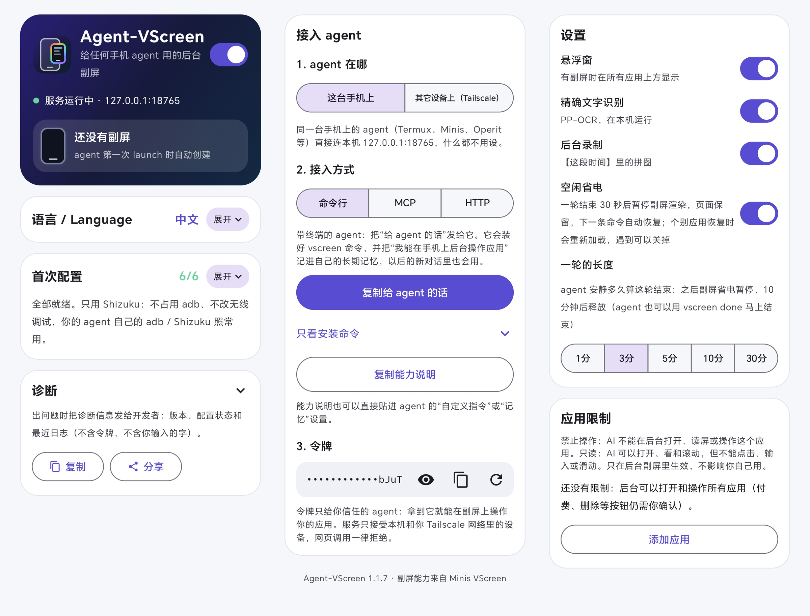

<p align="center"></p>

# Agent-VScreen

<p align="center">
  <a href="https://github.com/kilolonion/agent-vscreen/releases/latest"></a>
  <a href="LICENSE"></a>
  
  
  
</p>

给任何手机 agent 用的**后台副屏**。

中文 · [English](README.en.md)

Agent-VScreen 在一块看不见的虚拟屏上打开和操作别的应用，你的主屏照常用，不会被打断。屏幕上只有一个悬浮小窗，让你看到 AI 在做什么，随时可以接管或叫停。

手机上的任何 agent 都可以调用它：带终端的 agent 用命令行 `vscreen`，支持 MCP 的用 MCP，自己写代码的用 HTTP。

<p align="center"></p>
<p align="center"><sub>左：agent 在后台副屏里打开 Chrome 解数独（8 倍速）。右：agent 在后台副屏里玩洛克王国，完成横屏启动、摇杆长按走动、拖动镜头和战斗弹窗操作（2.6 倍速）。两边用户的主屏都仍是聊天界面。</sub></p>

<p align="center"></p>
<p align="center"><sub>同一条安装命令，Minis、Eta、RikkaHub、Muse 四个不同的安卓 agent 都能接入并操作副屏。</sub></p>

<p align="center"></p>
<p align="center"><sub>App 界面：首次配置、接入 agent（命令行 / MCP / HTTP）、设置和应用限制。</sub></p>

- 版本：1.1.6（versionCode 8）
- 包名：`com.kilon.agentvscreen`
- 系统：Android 11 及以上，推荐 Android 14 及以上
- 特权：只用 [Shizuku](https://shizuku.rikka.app/)，不需要 root

## 它能做什么

- **后台操作应用**：在副屏上启动应用、点击、滑动、输入文字、按键、等待画面变化，每一步都会核对结果。
- **把画面报告给 agent**：每次操作后返回现在的界面、能看到的文字和可点的元素，并附上截图。本应用不调用任何大模型，画面是什么意思由 agent 自己的模型判断。
- **盯守**：让副屏盯着某个条件（比如出现某段文字），满足时通知 agent。
- **悬浮窗**：
  - 边框的颜色表示现在谁在用副屏：彩虹色是 AI 在操作，蓝色是待命，绿色是你接管了，红色是你叫停了；
  - 拖动可以移动，双指捏合可以缩放；松手时手指还在动，小窗会顺势滑一段；
  - 甩向四个角会缩到最小，靠近屏幕边缘会折成贴边的小标签；
  - 按住画面 1 秒就能接管；
  - 右上角 × 点一下就关：AI 在工作时只收起小窗，AI 继续在后台干活；没有任务时直接关掉副屏。关闭不会停住 AI；
  - 左下角“停止 AI”才会停住 AI，停住后通知栏一直有提示，点“允许继续”就放开；
  - 也可以打开原生全屏页。
- **不和 agent 抢权限**：不占用 adb，不改无线调试的开关和端口，不重启 adbd。你的 agent 自己用的 adb 或 Shizuku 照常可用。一键配置只会把本应用“加进去”，不会改动别的应用的设置。

## 安装和配置

1. 安装 APK，打开 Agent-VScreen。
2. 确认 Shizuku 已经启动，然后点 **授权 Shizuku**。
3. 点 **一键配置其余项**：悬浮窗、通知、只读无障碍、电池优化和后台运行。荣耀、华为、小米、OPPO、vivo 等手机还有一项 **系统后台管理**，点 **去设置后台管理**，把 Agent-VScreen 改成手动管理，允许自启动、关联启动和后台活动。
   - 无障碍建议打开。开着它，悬浮窗不会在设置、安装器这类页面上被系统藏起来，元素列表和中文输入也更准。
4. 在 **接入 agent** 里点 **复制给 agent 的话**，原样发给你的 agent。它会装好 `vscreen` 命令，并按你的要求把一段说明存进它自己的长期记忆，以后的新对话里也知道手机上有这个工具。首页会显示它有没有记住。之后就能用 `vscreen` 了：

```sh
vscreen launch 设置
vscreen act "tap 搜索; type 关于手机; key enter until text:关于手机"
vscreen help all
```

### 荣耀、华为、小米等手机

这些系统的后台管理可能会把后台应用冻结。冻结后，agent 的命令会一直没有回应，直到你打开 Agent-VScreen。

1.1.3 做了这些防护：

- 服务运行时一直保留一个透明的 1 像素悬浮窗；
- 前台服务启动被拒时，改用 shell 身份重新启动；
- 每秒自检一次有没有被冻结。

如果首页出现 **后台运行受限**，点 **去设置**，把 Agent-VScreen 设为允许自启动、关联启动和后台活动。荣耀和华为在“应用启动管理”里改成“手动管理”。

## 让其它设备连进来（可选，默认关闭）

服务默认只监听本机的 `127.0.0.1:18765`。要从电脑或另一台手机调用，在“接入 agent”的 **让其它设备连进来** 里选 **内置 Tailscale**：不用装 Tailscale App，也不占系统 VPN，在 App 里登录一次 Tailscale 就行，只有你自己 Tailscale 网络里的设备连得进来。已经装了 Tailscale App 的也可以选 **Tailscale App**，或者用 SSH 端口转发。

令牌等于这台手机的操作权限，所以本应用不提供公网链接。

## 文档

- [API.md](API.md)：完整的接口和命令说明，包括命令行、MCP、HTTP、会话、盯守、悬浮窗、远程连接和已知限制。

## 1.1.x 更新内容

- **1.1.6**
  - 内置 Tailscale：不用另装 Tailscale App，在 App 里登录一次，电脑就能远程调用；不占系统 VPN；
  - 接入改成“复制给 agent 的话”：让 agent 自己把说明存进长期记忆，并报告存在哪；首页显示 agent 有没有记住；新增 `vscreen guide`，MCP 连接时自带用法；
  - 悬浮窗的关闭和停止分开：× 点一下就收起或关闭，不会再顺带停住 AI；“停止 AI”单独放在左下角，停住后有常驻通知和“允许继续”，agent 收到的提示也写明用户怎么解除；
  - 修复：电池白名单被系统收回后首页反复显示没配置（现在自动补上），熄屏时的冻结不再让“系统后台管理”重新亮起。
- **1.1.5**
  - 修复：用户接管过副屏或从悬浮窗关掉副屏后，agent 的动作一直被要求“先看清画面”。现在 launch 和 act 返回的画面就算看过，launch 打开新页面也不会被拒；
  - 命令行每次的完整输出另存到截图目录的 `last.txt`，输出太长时可以分段读；
  - 副屏上没有应用时提示用 launch 打开；“画面一直在变”和“画面没变”两句说法不再矛盾；
  - 新 logo：手机上叠一个彩虹边框的悬浮小窗。
- **1.1.4**
  - 安装命令会顺带输出一份 skill，agent 存进自己的 skill 或记忆后，就知道操作应用要用 vscreen，不需要 adb；
  - “系统后台管理”成为配置项，可以一键打开厂商的后台设置页；
  - 小窗拖到屏幕边缘时，以手指为中心连续缩成标签，拉出时从手指的位置长出来；
  - 首页的设置区块样式统一；logo 和标签里的副屏改成带导航条的小屏和触点。
- **1.1.3**
  - 修复：没有副屏时，App 在后台被冻结，命令要等你切回 App 才有回应。
  - 端口被占用时会自动重试，并写明被谁占用；首页可以立即重试或换端口。
  - 命令行 5 秒内就能认出 App 被冻结，不再干等；连本机时不走代理。
  - 贴边小标签换了新样式，会落在你松手的位置；“首次配置”加了展开和收起提示。
- **1.1.2**：打开全屏页时自动藏起悬浮窗；加了惯性甩动、甩到角落缩小、靠边折叠。
- **1.1.1**：悬浮窗挂在无障碍服务下面，不再在设置、安装器这类页面上消失；通知栏加了“查看副屏”；加了 Tailscale 模式。
- **1.1.0**：重做悬浮窗、全屏页、首页和图标；一步没达到预期就停在那一步；加了 `title`、`done`；命令行随 App 自动更新。

## 从源码编译

需要 JDK 17、Android SDK（compileSdk 36）。

```bash
echo "sdk.dir=/path/to/android-sdk" > local.properties
./gradlew :app:assembleRelease
```

内置 Tailscale 是一个用 Go 编的小程序（`tsbridge/`），需要 Go 1.21 以上（会按 `tsbridge/go.mod` 自动下载 Go 1.27.3）。编 APK 之前先运行一次 `tsbridge/build.sh`，它会生成 `app/src/main/jniLibs/arm64-v8a/libtsbridge.so`；不运行也能编，只是 App 里没有内置 Tailscale。

正式签名可选：把 `keystore.properties.example` 复制成 `keystore.properties` 并填好。不填的话，release 包用 debug 密钥签名。

## 许可

MIT。内置的 OCR 模型（`app/src/main/assets/vscreen-ocr/`）来自 PaddleOCR，沿用它自己的 Apache-2.0 许可。

## 致谢

- [LINUX DO](https://linux.do)
- [OpenMinis](https://github.com/OpenMinis)
