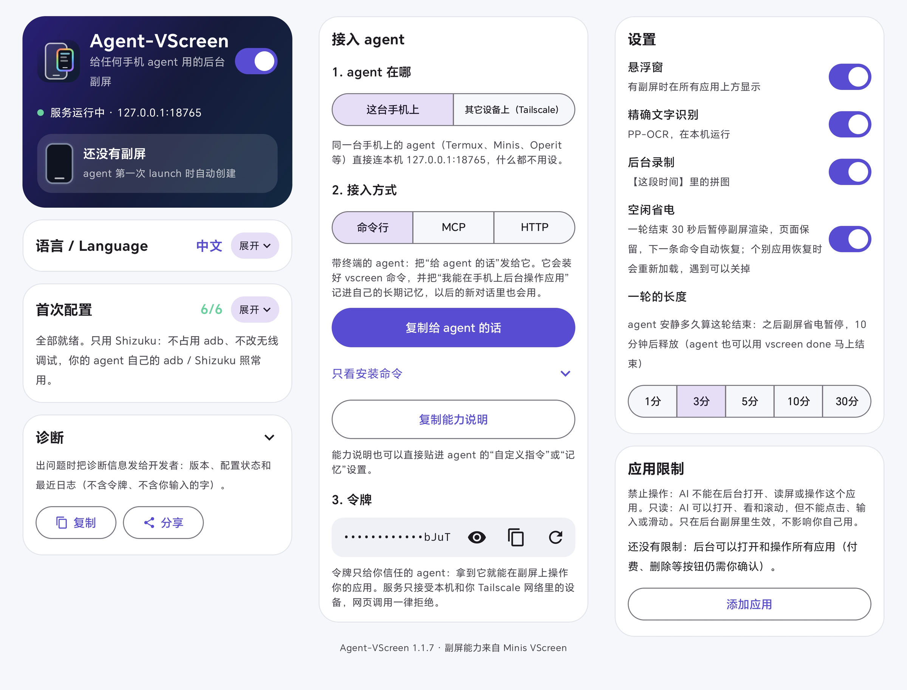

<p align="center"></p>

# Agent-VScreen

<p align="center">
  <a href="https://github.com/kilolonion/agent-vscreen/releases/latest"></a>
  <a href="LICENSE"></a>
  
  
  
</p>

安卓手机上的**后台副屏**，手机、电脑或云端的 AI agent 都能用。

中文 · [English](README.md)

Agent-VScreen 在一块看不见的虚拟屏上打开和操作别的应用，你的主屏照常用，不会被打断；屏幕上只有一个悬浮小窗，让你看到 AI 在做什么，随时可以接管或叫停。不绑定任何模型或客户端，支持命令行 `vscreen`、MCP 与 HTTP。

<!-- version:start -->
- `main` 分支版本：2.0.1-beta2（versionCode 76） · [最新正式版 APK](https://github.com/kilolonion/agent-vscreen/releases/latest) · [全部版本 / 测试版](https://github.com/kilolonion/agent-vscreen/releases)
<!-- version:end -->
- 环境：Android 11+（arm64，推荐 Android 14+） · 包名 `com.kilon.agentvscreen` · 特权：[Shizuku](https://shizuku.rikka.app/) / 兼容分支或 Root

<p align="center"></p>
<p align="center"><sub>你在 Chrome 里照常看网页，agent 在后台副屏里打开时钟并启动 10 分钟定时器（等待部分 6 倍速）。</sub></p>

<p align="center"></p>

<details>
<summary>更多演示、多 agent 接入图与 2 分钟新手教学视频</summary>

<p align="center"><a href="docs/promo/tutorial.zh.mp4?raw=true"></a></p>
<p align="center"><sub>2 分钟新手教学视频（中文配音）：<a href="docs/promo/tutorial.zh.mp4?raw=true">下载 MP4</a></sub></p>

<p align="center"></p>
<p align="center"><sub>随时接管：长按悬浮窗自己操作副屏，用完交还给 agent 继续。<a href="docs/promo/takeover.mp4?raw=true">下载 MP4</a></sub></p>

<p align="center"></p>
<p align="center"><sub>同一条安装命令，Minis、Eta、RikkaHub、Muse 均可接入并操作副屏。</sub></p>

<p align="center"></p>
<p align="center"><sub>App 界面一览（<a href="docs/promo/tour.mp4?raw=true">下载 MP4</a> · <a href="docs/promo/background.mp4?raw=true">后台演示 MP4</a> · <a href="docs/promo/mix.mp4?raw=true">34 秒混剪版</a>）。配乐：“Wallpaper”，Kevin MacLeod（incompetech.com），<a href="https://creativecommons.org/licenses/by/4.0/">CC BY 4.0</a>。</sub></p>

</details>

## 核心特性

- **真正后台操作**：在隔离副屏上打开、点、滑、输入、按键和等待变化，每一步核对结果；不占 adb、不改无线调试。
- **看得清、跟得上**：融合只读无障碍树与离线 OCR（PP-OCRv6 / ML Kit），按时间线回报画面变化与闪烁弹窗，支持区域放大、录像回看、翻页采集与条件盯守。
- **随时接管与协作**：悬浮窗边框色标明当前控制权，长按 0.5 秒接管或一键叫停；支持请用户指点（`ask`）、亲手演示存为可复现步骤（`teach`）及密码步骤交回主屏（`handoff`）。
- **细粒度权限与强确认**：每个 agent 独立令牌与六行权限表（只看 / 稳妥 / 省心 / 全权），应用可设禁止或只读，付款与高风险操作须经手机端独立强确认页生物识别/PIN 放行。
- **不绑模型与框架**：手机端不调用任何大模型，任何支持 CLI、MCP 或 HTTP 的 agent 都能直接使用。

## 快速开始

### 1. 安装与配置

1. 下载并安装 APK，打开 Agent-VScreen。
2. 在 **首次配置** 中选择权限来源：
   - **Shizuku / 兼容分支（默认）**：先启动 Shizuku（或 Sui、AXManager 等 `API_V23` 兼容分支），点击 **授权**；手机重启后需重新启动服务。
   - **Root**：已 root 手机（或 Android 17+ 官方 Shizuku 受限时）点击 **改用 Root（无需 Shizuku）** 并允许授权，无需安装 Shizuku。
3. 点击 **自动开启** 完成悬浮窗、通知、只读无障碍与电池白名单配置；国产系统建议顺手在系统后台管理中允许自启动与后台活动。

<a id="验证下载的-apk"></a>
<details>
<summary>验证下载的 APK 签名证书</summary>

安装前可用 Android SDK Build Tools 自带的 [`apksigner`](https://developer.android.com/tools/apksigner) 验证并核对官方发布证书（`CN=Agent-VScreen`）SHA-256 指纹：

```sh
apksigner verify --print-certs downloaded.apk
```

`56:B1:48:24:54:9E:69:80:17:EB:A9:07:CB:C3:34:7E:E3:A4:BA:30:90:7E:FB:D6:06:8E:A5:1F:F4:49:57:56`

`apksigner` 输出小写且不带冒号；应核对证书指纹而非 APK 文件哈希，验证失败或指纹不符请勿安装。

</details>

### 2. 接入 agent

在 App 底部 **接入 › 新建接入** 中按向导选择运行位置与连接方式，点击 **复制给 agent 的话** 原样发给它即可。新令牌默认长期有效，也可选 30 天、7 天、1 天；命令行、HTTP 与 Operit 还可选 **10 分钟一次性接入码（`avc_...`）**，让令牌不进聊天记录和命令历史；复制凭证时自动标记系统敏感剪贴板隐藏预览。

| 场景 | 连接方式 | 说明 |
|---|---|---|
| **本机**（默认） | 命令行 `vscreen` / MCP / HTTP / [Operit ToolPkg](integrations/operit/) | 仅监听 `127.0.0.1:18765`，手机外不可达 |
| **私有远程** | 内置 Tailscale（推荐，支持 Headscale）/ Tailscale App / SSH | 仅限私有网络内设备，非内置方式默认要求请求签名 |
| **云端公网 MCP**（实验性，默认关闭） | Tailscale Funnel / Cloudflare Tunnel / ngrok + OAuth 2.1 | 手机弹出配对确认卡（显示配对码与来源地址，生物识别/PIN 确认）；永不开放 `system`；24 小时无已认证请求自动关闭 |

完整连接协议、安全边界、能力清单与已知限制见 [API.md](API.md)。

## 文档

- [API.md](API.md)：接口、能力清单、会话与盯守、权限与安全、远程/公网 MCP 与已知限制。
- [docs/REFERENCE.md](docs/REFERENCE.md)：所有命令参数与结果代码（由源码生成）。
- [docs/CHANGELOG.zh-CN.md](docs/CHANGELOG.zh-CN.md)：完整版本更新记录（[English](docs/CHANGELOG.md)）。
- [docs/TASKS.md](docs/TASKS.md) · [docs/RELEASE-PROCESS.md](docs/RELEASE-PROCESS.md)：发版前真机任务集与发布安全门禁。

## 从源码编译

需要 JDK 21 与 Android SDK（compileSdk 37）：

```bash
echo "sdk.dir=/path/to/android-sdk" > local.properties
./gradlew :app:assembleRelease
```

如需打包内置 Tailscale/ngrok（`tsbridge/`）与 Cloudflare Tunnel（`cloudflared/`）通道，编译前先运行 `./tsbridge/build.sh` 与 `./cloudflared/build.sh`；签名配置模板见 [`keystore.properties.example`](keystore.properties.example)，发布流程见 [docs/RELEASE-PROCESS.md](docs/RELEASE-PROCESS.md)。

## 许可与致谢

MIT。内置 OCR 模型（`app/src/main/assets/vscreen-ocr/`）来自 PaddleOCR（Apache-2.0）；可选无字图标检测模型（`app/src/main/assets/vscreen-detector/model.onnx` 及 [agent-vscreen-models](https://github.com/kilolonion/agent-vscreen-models)）为独立 AGPL-3.0 数据文件，仅在用户同意后启用。

致谢：[LINUX DO](https://linux.do) · [OpenMinis](https://github.com/OpenMinis)
